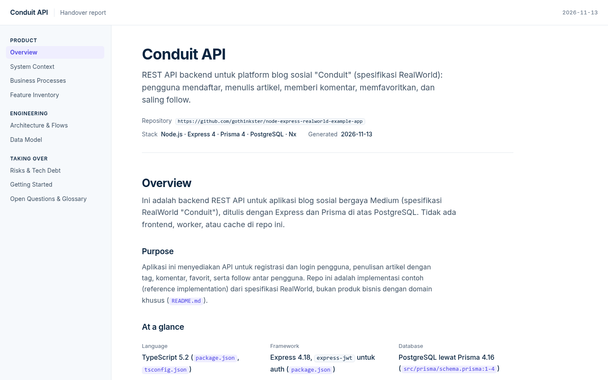

# unpack-this

An agent skill that unpacks a handed-over codebase into a handover report. It writes both `docs/handover/HANDOVER.md` and an interactive, docs-style `docs/handover/handover.html`.

The report follows a lightweight [arc42](https://arc42.org) outline with [C4](https://c4model.com) diagrams, ordered by the questions a new owner asks:

1. **Overview**: what it is and what it is built with
2. **System Context**: actors and external systems
3. **Business Processes**: end-to-end flow and business rules
4. **Feature Inventory**: modules, features, code locations
5. **Architecture & Runtime Flows**: building blocks and critical sequences
6. **Data Model**: core entities and status lifecycle
7. **Risks & Technical Debt**: findings by severity
8. **Getting Started**: running it locally
9. **Open Questions & Glossary**

Every claim cites a file path; anything not confirmed by code is marked `inferred`.

## Install

```bash
npx skills add lejar14/unpack-this
```

Works with any agent supported by the [skills CLI](https://github.com/vercel-labs/skills) (Claude Code, Codex, Cursor, OpenCode, pi, and others). Add `-g` to install globally instead of per project.

## Usage

Open the inherited repo in your agent and ask, for example:

- "Unpack this repo, I just took it over."
- "Explain the business flow of this project."
- "Bantu onboarding codebase ini." (the report follows your language)

## Requirements

- An agent that reads `SKILL.md` skills.
- **Node 18+** to run the report checker (`scripts/check-report.mjs`). It needs no network or npm install.
- **Internet when opening `handover.html`**, so diagrams can load from jsDelivr. Without it, each diagram shows its Mermaid source instead (see [Offline reports](#offline-reports)).

## Output

| File | What it is |
| :--- | :--- |
| `docs/handover/HANDOVER.md` | Full report in Markdown, the source of truth. GitHub renders its Mermaid blocks natively. |
| `docs/handover/handover.html` | Same report as a docs-style page: grouped sidebar, filterable tables, copyable commands, rendered diagrams, light and dark mode. |

Before finishing, the agent runs `scripts/check-report.mjs`, which fails on unfilled placeholders, missing or empty sections, Markdown and HTML out of sync, Mermaid diagrams that do not parse, or a modified script tag.

### Example

A real run on [RealWorld Conduit](https://github.com/gothinkster/node-express-realworld-example-app) (Express + Prisma), written in Indonesian because that is the language it was asked in: [`examples/conduit/HANDOVER.md`](examples/conduit/HANDOVER.md) · [`examples/conduit/handover.html`](examples/conduit/handover.html) (download and open locally to view it rendered).



## Offline reports

Diagrams are rendered by [Pele](https://pele.run) 1.13.0 (MIT), loaded from jsDelivr with a pinned version and a Subresource Integrity hash, so a tampered CDN file is refused by the browser.

To make a report work without internet, ask the agent for an offline report, or do it by hand:

1. Copy `assets/pele.global.js` from the installed skill (e.g. `.claude/skills/unpack-this/assets/`) next to `handover.html`.
2. In `handover.html`, replace the Pele `<script src="https://cdn.jsdelivr.net/...">` tag with `<script src="pele.global.js"></script>`. Drop the `integrity` attribute: browsers cannot verify it for a local file opened from disk.

## License

MIT. Bundles Pele 1.13.0 (`skills/unpack-this/assets/pele.global.js`), MIT, see `assets/pele.LICENSE`.
