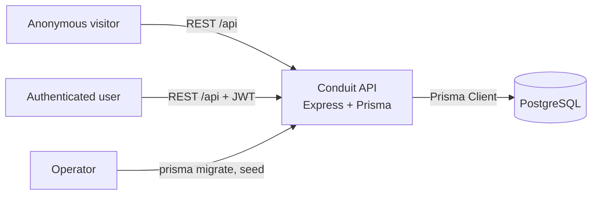
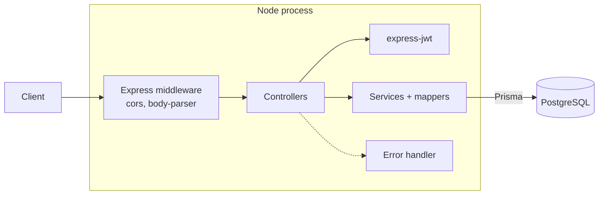
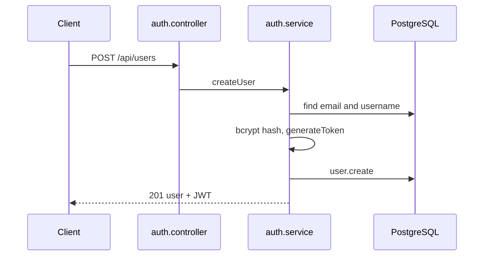
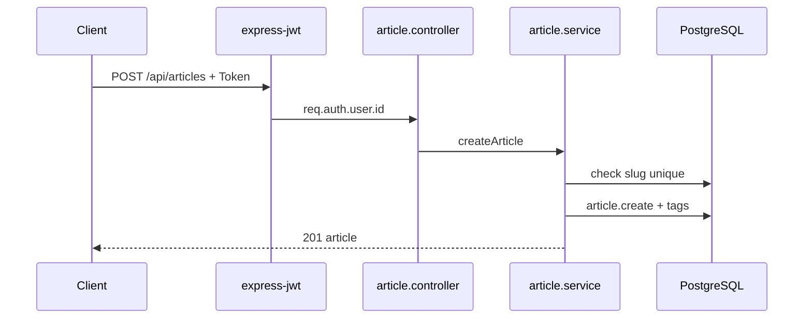
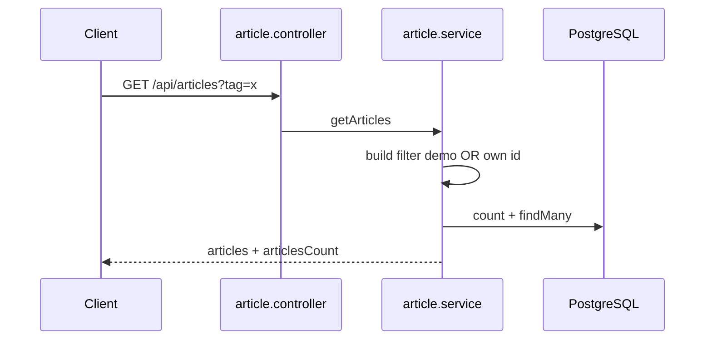
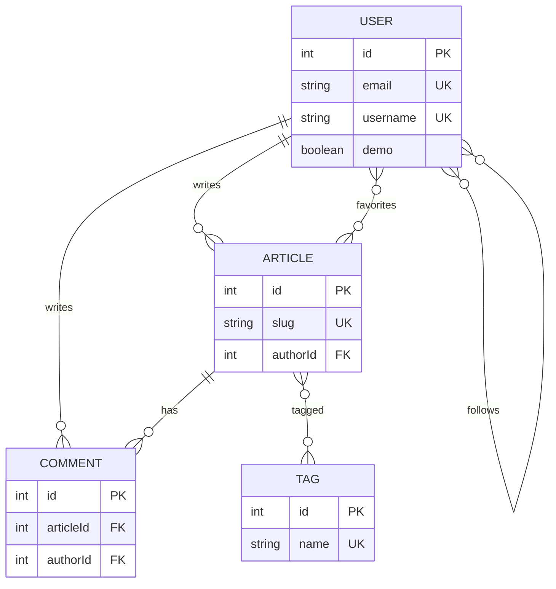

# Conduit API: Handover Report

## Overview

Ini adalah backend REST API untuk aplikasi blog sosial bergaya Medium (spesifikasi RealWorld "Conduit"), ditulis dengan Express dan Prisma di atas PostgreSQL. Tidak ada frontend, worker, atau cache di repo ini.

### Purpose

Aplikasi ini menyediakan API untuk registrasi dan login pengguna, penulisan artikel dengan tag, komentar, favorit, serta follow antar pengguna. Repo ini adalah implementasi contoh (reference implementation) dari spesifikasi RealWorld, bukan produk bisnis dengan domain khusus (`README.md`).

### At a glance

- **Language**: TypeScript 5.2 (`package.json`, `tsconfig.json`)
- **Framework**: Express 4.18, `express-jwt` untuk auth (`package.json`)
- **Database**: PostgreSQL lewat Prisma 4.16 (`src/prisma/schema.prisma:1-4`)
- **Cache / queue**: Tidak ada (tidak ada import atau config terkait)
- **Frontend**: Tidak ada; hanya API plus static file di `src/assets/` (`src/main.ts:19`)
- **Build / monorepo tool**: Nx 17 dengan esbuild, target `api` di `project.json`
- **Hosting / infra**: Dockerfile hasil generate Nx (`Dockerfile`); tidak ada CI atau IaC di repo

## System Context

API ini dipakai oleh klien frontend RealWorld (tidak ada di repo) dan hanya bergantung pada satu database PostgreSQL; tidak ada integrasi pihak ketiga di kode.

### Actors / roles

- **Anonymous visitor** (tanpa token): Boleh membaca daftar artikel, detail artikel, komentar, profil, dan tag, serta mendaftar atau login. Endpoint ini memakai `auth.optional`. `src/app/routes/auth/auth.ts:19-24`
- **Authenticated user** (JWT): Menulis, mengubah, dan menghapus artikel miliknya; berkomentar; favorit dan unfavorit; follow dan unfollow; mengubah profil sendiri. Endpoint ini memakai `auth.required`. `src/app/routes/article/article.controller.ts`
- **Demo user** (flag `demo` di tabel User): Bukan peran di API, tetapi user hasil seed yang kontennya terlihat oleh semua orang. Konten user non-demo hanya terlihat oleh pemiliknya di listing (lihat Business Processes). `src/prisma/seed.ts:21-28`
- **Operator / developer** (CLI): Menjalankan migrasi Prisma dan seed data lewat command line, bukan lewat HTTP. `package.json`

### External systems

- **PostgreSQL** (database): Satu-satunya sistem eksternal; koneksi lewat variabel `DATABASE_URL`. `src/prisma/schema.prisma:1-4`
- **Gambar avatar default** (URL statis): Nilai default kolom `image` menunjuk ke host `api.realworld.io`; hanya string URL, API tidak memanggilnya. `src/prisma/schema.prisma:48`

Tidak ditemukan payment gateway, email/SMS, object storage, auth provider eksternal, atau message broker (hasil pencarian import di `src/` dan `package.json`).

### Context diagram



*Konteks sistem (C4 level 1)*

## Business Processes

Alur utamanya adalah pengguna mendaftar, menerbitkan artikel, lalu berinteraksi lewat komentar, favorit, dan follow; semua dijalankan sinkron per request HTTP tanpa job latar belakang.

### End-to-end flow

Register / Login → Publish article → Browse (list, feed, tag) → Comment → Favorite → Follow author

**Registrasi dan login.** `POST /api/users` memvalidasi email, username, password (tidak boleh kosong setelah di-trim), memeriksa keunikan, melakukan hash bcrypt, menyimpan user, dan langsung mengembalikan JWT. `POST /api/users/login` membandingkan hash dan mengembalikan token baru (`src/app/routes/auth/auth.service.ts:38-129`).

**Menulis artikel.** `POST /api/articles` membuat slug dari judul ditambah id penulis, membuat tag baru bila belum ada (`connectOrCreate`), dan mengembalikan artikel yang sudah dipetakan. Hanya penulis yang boleh mengubah atau menghapus (`src/app/routes/article/article.service.ts:162-239`, `:289-414`).

**Membaca konten.** `GET /api/articles` mendukung filter `tag`, `author`, `favorited`, paginasi `limit` dan `offset`. `GET /api/articles/feed` hanya menampilkan artikel dari user yang di-follow. Listing dibatasi oleh aturan visibilitas `demo` di bawah (`article.service.ts:8-111`, `:113-160`).

**Interaksi sosial.** Komentar, favorit, dan follow semuanya relasi many-to-many atau one-to-many di Prisma; favorit dan follow dilakukan dengan `connect` dan `disconnect` sehingga idempotent (`article.service.ts:562-651`, `src/app/routes/profile/profile.service.ts:22-60`).

> **Aturan visibilitas tidak standar.** Listing artikel, komentar, dan tag hanya menampilkan konten dari author dengan `demo = true` atau milik user yang sedang login. Artinya user non-demo tidak melihat artikel user non-demo lain di listing, tetapi `GET /articles/:slug` tidak memakai filter ini (`article.service.ts:13-25`, `:241-274`). Tujuan bisnisnya tidak terdokumentasi (inferred: mencegah konten publik di instance demo).

### Business rules

| Rule | Condition / value | Enforced in |
| :--- | :--- | :--- |
| Field wajib registrasi | email, username, password tidak boleh kosong setelah `trim()`; gagal dengan 422 | `src/app/routes/auth/auth.service.ts:39-54` |
| Keunikan user | email dan username unik; 422 `has already been taken`; juga unique index DB | `src/app/routes/auth/auth.service.ts:9-36`, `src/prisma/schema.prisma:45-46` |
| Hash password | bcrypt cost 10 saat register dan saat ganti password | `src/app/routes/auth/auth.service.ts:58`, `:156` |
| Token | JWT HS256, payload `user.id`, kedaluwarsa 60 hari | `src/app/routes/auth/token.utils.ts:3-6`, `src/app/routes/auth/auth.ts:19` |
| Header auth | Skema `Token` atau `Bearer`; `optional` tidak menolak request tanpa token | `src/app/routes/auth/auth.ts:4-24` |
| Login gagal | Pesan generik `email or password is invalid` dengan status 403 | `src/app/routes/auth/auth.service.ts:124-128` |
| Field wajib artikel | title, description, body wajib; 422 bila kosong | `src/app/routes/article/article.service.ts:166-176` |
| Slug artikel | `slugify(title)-<authorId>`; bila sudah ada, 422 `must be unique` | `src/app/routes/article/article.service.ts:178-191` |
| Slug berubah saat judul berubah | Judul baru menghitung ulang slug dan URL lama tidak berlaku | `src/app/routes/article/article.service.ts:316-333`, `:353` |
| Update tag | Semua tag diputus lalu dibuat ulang dari `tagList`; tanpa `tagList` artinya semua tag terhapus | `src/app/routes/article/article.service.ts:335-358` |
| Otorisasi artikel | Hanya penulis boleh update atau delete; 403 bila bukan; 404 bila tidak ada | `src/app/routes/article/article.service.ts:306-314`, `:400-408` |
| Komentar | body wajib; hanya penulis komentar boleh menghapus | `src/app/routes/article/article.service.ts:474-476`, `:527-553` |
| Visibilitas listing | Hanya author `demo = true` atau user yang login | `src/app/routes/article/article.service.ts:13-25`, `:417-431` |
| Paginasi | Default `limit` 10 dan `offset` 0; urut `createdAt` desc | `src/app/routes/article/article.service.ts:79-83` |
| Feed | Hanya artikel dari user yang di-follow oleh user login | `src/app/routes/article/article.service.ts:113-131` |
| Tag populer | 10 tag teratas berdasarkan jumlah artikel, dengan visibilitas yang sama | `src/app/routes/tag/tag.service.ts:4-35` |
| Cascade delete | Hapus user menghapus artikel dan komentarnya; hapus artikel menghapus komentarnya | `src/prisma/schema.prisma:20`, `:31`, `:33` |
| Avatar default | Bila `image` kosong, dipakai URL smiley-cyrus | `src/prisma/schema.prisma:48` |

## Feature Inventory

Ada lima modul HTTP di bawah prefix `/api` (auth, profile, article, comment di dalam article, tag) ditambah health check dan static file; seluruhnya terdaftar di satu router.

| Module | Key Features | Code Location | Notes |
| :--- | :--- | :--- | :--- |
| Auth / User | `POST /users` register, `POST /users/login`, `GET /user`, `PUT /user` | `src/app/routes/auth/` | JWT 60 hari; update user tanpa validasi keunikan |
| Profile | `GET /profiles/:username`, `POST` dan `DELETE /profiles/:username/follow` | `src/app/routes/profile/` | Follow lewat relasi self-many-to-many `UserFollows` |
| Articles | List, feed, create, get, update, delete (`/articles`, `/articles/feed`, `/articles/:slug`) | `src/app/routes/article/` | Slug = judul + id penulis; listing terfilter `demo` |
| Comments | List, add, delete di `/articles/:slug/comments` | `src/app/routes/article/article.service.ts:416-560` | Delete mengabaikan slug |
| Favorites | `POST` dan `DELETE /articles/:slug/favorite` | `src/app/routes/article/article.service.ts:562-651` | Relasi `UserFavorites` |
| Tags | `GET /tags` (10 populer) | `src/app/routes/tag/` | Tag dibuat otomatis saat artikel dibuat |
| Health / static | `GET /` mengembalikan status; file di `src/assets/` disajikan statis | `src/main.ts:19-24` | e2e test mengharapkan respons berbeda |
| Seed | Membuat 12 user demo, 12 artikel per user, dan komentar dari semua user | `src/prisma/seed.ts` | Dijalankan lewat `npx prisma db seed` |
| Error handling | Memetakan `HttpException` ke status HTTP; `UnauthorizedError` ke 401 | `src/main.ts:26-48`, `src/app/models/http-exception.model.ts` | Error lain jadi 500 dengan pesan mentah |

## Architecture & Runtime Flows

Satu proses Node/Express stateless yang berlapis routes/controller ke service ke Prisma ke PostgreSQL; tidak ada worker atau scheduler terpisah.

### Building blocks

Layering: `routes.ts` memasang semua controller di bawah `/api`; controller (`*.controller.ts`) menangani HTTP dan memilih `auth.required` atau `auth.optional`; service (`*.service.ts`) memegang business rule dan memanggil Prisma; mapper (`*.mapper.ts`, `profile.utils.ts`) membentuk respons sesuai spesifikasi (`src/app/routes/routes.ts:7-13`). Prisma client dibuat di `src/prisma/prisma-client.ts`.



*Container diagram (C4 level 2)*

### Critical flows



*Register dan login*



*Membuat artikel (auth required)*



*Listing artikel dengan filter visibilitas*

## Data Model

Empat model Prisma (User, Article, Comment, Tag) dengan dua relasi many-to-many implisit (favorit dan follow); tidak ada kolom status sehingga tidak ada state machine.

### Core entities

- **`User`** (tabel utama): Kolom `email` dan `username` unik, `password` (hash bcrypt), `image`, `bio`, dan `demo` (default false). Relasi: `articles`, `favorites`, `followedBy` dan `following` (self-relation `UserFollows`), `comments`. `src/prisma/schema.prisma:43-56`
- **`Article`** (konten): Kolom `slug` unik, `title`, `description`, `body`, timestamp. Relasi ke `author` (cascade), `tagList`, `favoritedBy`, `comments`. `src/prisma/schema.prisma:11-24`
- **`Comment`** (konten): Kolom `body` dan timestamp, milik satu `Article` dan satu `User`, keduanya `onDelete: Cascade`. `src/prisma/schema.prisma:26-35`
- **`Tag`** (label): Kolom `name` unik; many-to-many implisit dengan `Article` (tabel join dibuat migrasi `implicit_tags`). `src/prisma/schema.prisma:37-41`

Skema dikelola lewat 4 migrasi SQL di `src/prisma/migrations/` (initial, implicit_tags, api_url, deprecated_preview).



*ER diagram*

### Status lifecycle

N/A: tidak ada kolom status di model mana pun (`src/prisma/schema.prisma`), jadi tidak ada state diagram.

## Risks & Technical Debt

Risiko terbesar adalah secret JWT dengan fallback hardcoded, tidak adanya CI dan test yang valid, serta beberapa jalur yang berakhir 500 karena validasi hilang; tidak ada cron, queue, atau webhook tersembunyi.

### Hidden logic

Tidak ditemukan cron, scheduler, queue worker, event listener, webhook, atau DB trigger (pencarian di `src/` dan migrasi SQL). Satu-satunya logika "tersembunyi" adalah `ON DELETE CASCADE` di database dan skrip seed manual di `src/prisma/seed.ts`.

### Findings

- **High · Secret JWT punya fallback hardcoded.** Bila `JWT_SECRET` tidak di-set, token ditandatangani dengan string default yang ada di source, sehingga siapa pun bisa memalsukan token user mana pun. Wajibkan variabel itu dan gagal saat startup bila kosong. `src/app/routes/auth/auth.ts:16`, `src/app/routes/auth/auth.ts:21`, `src/app/routes/auth/token.utils.ts:4`
- **High · Tidak ada CI, `.env.example`, dan test e2e basi.** Tidak ada workflow CI, jadi test tidak pernah dijalankan otomatis. Test e2e mengharapkan `{ message: 'Hello API' }` padahal `GET /` mengembalikan `{ status: ... }`, dan `tag.service.test.ts` berisi 6 baris tanpa test. Tambahkan CI minimal dan perbaiki e2e. `e2e/src/server/server.spec.ts:7`, `src/main.ts:21`, `src/tests/services/tag.service.test.ts`
- **Medium · Jalur yang berakhir 500 karena validasi hilang.** Komentar pada slug yang tidak ada memanggil `connect` dengan `id` undefined; follow, favorite, dan unfavorite pada target yang tidak ada melempar error Prisma; `updateUser` tidak memeriksa keunikan email atau username. Semuanya jatuh ke error handler dan jadi 500. Tambahkan cek 404 dan 422 eksplisit. `src/app/routes/article/article.service.ts:478`, `src/app/routes/profile/profile.service.ts:23`, `src/app/routes/auth/auth.service.ts:151`
- **Medium · Error handler membocorkan pesan internal.** Error non-`HttpException` dikembalikan sebagai 500 dengan `err.message` mentah (pesan Prisma bisa memuat detail query). Kembalikan pesan generik dan log detailnya. `src/main.ts:43`
- **Medium · Update artikel tidak atomik.** Tag diputus di query terpisah sebelum update; bila update gagal, artikel kehilangan semua tag. Bungkus dalam `prisma.$transaction`. `src/app/routes/article/article.service.ts:343`
- **Medium · Aturan visibilitas `demo` tidak konsisten.** Listing, komentar, dan tag disaring berdasarkan `demo` atau pemilik, tetapi detail artikel tidak. Perilaku ini juga menyimpang dari spesifikasi RealWorld; konfirmasi ke tim lama apakah disengaja. `src/app/routes/article/article.service.ts:13`, `src/app/routes/article/article.service.ts:241`
- **Medium · Validasi input lemah dan tanpa pembatasan.** Tidak ada validasi format email, panjang password, atau batas panjang input; `cors()` terbuka untuk semua origin; tidak ada rate limiting pada login. Tambahkan schema validation dan batasan. `src/app/routes/auth/auth.service.ts:38`, `src/main.ts:13`
- **Medium · Dockerfile bergantung pada build di luar image.** Image hanya menyalin `dist/api` yang harus sudah dibangun sebelumnya, dan tidak menjalankan `prisma generate` atau migrasi. Apakah Prisma client ikut ter-bundle belum bisa dipastikan dari kode (inferred: perlu `prisma generate` di langkah build). `Dockerfile:22`
- **Low · `deleteComment` mengabaikan slug dan cabang 403 tidak terjangkau.** Query sudah memfilter penulis sehingga komentar orang lain menghasilkan 404, bukan 403; slug di URL tidak diperiksa. Rapikan agar perilaku sesuai niat. `src/app/routes/article/article.service.ts:527`
- **Low · Token 60 hari tanpa revocation.** Tidak ada refresh token atau daftar cabut; token bocor valid sampai kedaluwarsa. Pertimbangkan masa berlaku lebih pendek. `src/app/routes/auth/token.utils.ts:5`
- **Low · Dokumentasi usang.** JSDoc route menyebut `/article/:slug` dan `/api/tags` yang berbeda dari path sebenarnya; badge build di README menunjuk fork Travis lama. `src/app/routes/article/article.controller.ts:83`, `src/app/routes/tag/tag.controller.ts:10`, `README.md:3`

Dependency utama sudah lama (Prisma 4, Express 4, Nx 17). Audit dependency belum dilakukan; saya bisa melakukannya bila diminta.

## Getting Started

Butuh Node.js, PostgreSQL, dan tiga variabel environment; setelah install, generate Prisma client, jalankan migrasi, lalu `nx serve api`.

Prasyarat: Node.js (versi tidak dipin; Dockerfile memakai `node:lts-alpine`) dan sebuah database PostgreSQL. Variabel yang dibutuhkan (hanya nama): `DATABASE_URL`, `JWT_SECRET`, `NODE_ENV`; opsional `PORT` (default 3000) dan `HOST`. Repo tidak punya `.env.example`; daftar di atas diambil dari `README.md` dan kode.

1. **Install dependency.** Dari root repo.

   ```bash
   npm install
   ```
2. **Siapkan environment.** Buat file `.env` di root berisi `DATABASE_URL`, `JWT_SECRET`, `NODE_ENV` (isi sendiri; jangan di-commit).
3. **Generate Prisma client.** Membuat tipe dari `src/prisma/schema.prisma`.

   ```bash
   npx prisma generate
   ```
4. **Terapkan migrasi.** Membuat atau memperbarui tabel.

   ```bash
   npx prisma migrate deploy
   ```
5. **Jalankan server.** Server mendengarkan di port 3000 dan API di `/api`.

   ```bash
   npx nx serve api
   ```
6. **Isi data demo (opsional).** Menjalankan `src/prisma/seed.ts`.

   ```bash
   npx prisma db seed
   ```
7. **Jalankan test.** Unit test jest memakai mock Prisma (`src/tests/prisma-mock.ts`); test e2e di `e2e/` butuh server hidup dan saat ini basi.

   ```bash
   npx nx test api
   ```
8. **Build dan deploy.** Perintah deploy dari README; Docker memakai `npx nx docker-build api` setelah build.

   ```bash
   npm ci && npx prisma migrate deploy && node dist/api/main.js
   ```

File minimum yang tidak ada: `.env.example`, `docker-compose.yml`, `Makefile`, `Procfile`, dan CI config (`.github/`, `.gitlab-ci.yml`, dan sejenisnya). Karena itu langkah di atas bersumber dari `README.md`, `project.json`, dan `package.json`.

## Open Questions & Glossary

Ada beberapa keputusan desain dan operasional yang tidak bisa dipastikan dari kode dan perlu dikonfirmasi ke tim sebelumnya; istilah domain relatif sedikit karena mengikuti RealWorld.

### Open questions

- **Apakah filter visibilitas `demo` disengaja?**: Listing hanya menampilkan konten user demo dan milik sendiri, sedangkan detail artikel tidak disaring. Perlu tahu tujuan bisnisnya. `src/app/routes/article/article.service.ts:13-25`
- **Bagaimana deployment production dilakukan?**: Tidak ada CI, IaC, atau docker-compose; hanya Dockerfile Nx dan perintah di README. Siapa yang menjalankan migrasi dan di mana? `Dockerfile`
- **Apakah `prisma generate` dijalankan saat build image?**: Dockerfile tidak memuatnya; belum jelas bagaimana client tersedia di runtime. `Dockerfile:22`
- **Apakah ada data atau klien yang bergantung pada slug lama?**: Slug berubah saat judul diedit dan URL lama jadi 404. `src/app/routes/article/article.service.ts:316-333`
- **Di mana frontend dan nilai `JWT_SECRET` production?**: Repo ini hanya API; konfirmasi klien yang memakainya dan pengelolaan secret. `README.md`

### Glossary

- **RealWorld / Conduit**: Spesifikasi API lintas-bahasa untuk klon Medium; "Conduit" adalah nama aplikasinya. `README.md`
- **Slug**: Pengenal artikel di URL: judul yang di-slugify ditambah `-<authorId>`. `src/app/routes/article/article.service.ts:178`
- **Demo user**: User dengan `demo = true`, dibuat oleh seed; kontennya terlihat oleh semua orang di listing. `src/prisma/schema.prisma:55`
- **Feed**: Daftar artikel dari penulis yang di-follow user login. `src/app/routes/article/article.service.ts:113`
- **Favorite**: Relasi user menandai artikel; jumlahnya tampil sebagai `favoritesCount`. `src/app/routes/article/article.mapper.ts:12`
- **Profile**: Tampilan publik user (username, bio, image, `following`). `src/app/routes/profile/profile.utils.ts`
- **`auth.required` / `auth.optional`**: Dua middleware JWT: wajib token atau token opsional. `src/app/routes/auth/auth.ts:14-24`

